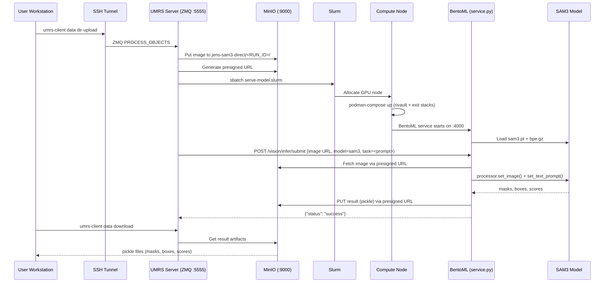

# Demo 11 — SAM3 Direct: Technical Data & Calculation Flow

## Architecture Overview



## File Inventory

| File | Role |
|------|------|
| `11_sam3_direct/README.md (step-by-step commands)` | Demo orchestrator (bash) |
| `demos/lib/common.sh` | Shared helpers: preflight, upload, download |
| `internal_genAI/bento/service.py` | BentoML service: model registry + inference dispatch |
| `internal_genAI/bento/sam3infer/bpe.gz` | SAM3 text tokenizer (BPE) |
| `internal_genAI/bento/sam3infer/sam3.pt` | SAM3 model weights |
| `internal_genAI/bento/Dockerfile` | Container image: Python 3.14 + torch + sam3 |
| `internal_genAI/serve-model.slurm` | Slurm job: podman-compose orchestration |
| `internal_genAI/serve-model.yaml` | Compose file: NGINX → BentoML (as "litellm") |
| `internal_genAI/userdata-access.yaml` | Compose file: exit NGINX + CoreDNS for S3 access |
| `demos/sample_data/images/Cat_1.jpg` | Default input image |

---

## Detailed Flow

### 1. Experience Generation

**File**: `11_sam3_direct/README.md (step-by-step commands)` → `generate_experience()`

```python
# README.md (step-by-step commands) lines 20-53 — inline Python generates the experience JSON
payload = {
    "xp_name": "Jens SAM3 Direct",
    "sql_username": "jens_sam3_direct",
    "modalities": [
        {
            "modality_name": "image",
            "task": "segmentation",
            "s3": {
                "bucket_alias": bucket_alias,   # "jens-sam3-direct"
                "need_output_bucket": True,
                "data": {"type": "file", "mime_type": "image/png"},
            },
            "model": {
                "model_name": "internal-genai-sam3",
                "vector_size": "256",
                "model_type": "rivault://bentoml://http://localhost:{LOCAL_PORT}/vision/infer/submit",
                "vision_model_type": "sam3",
                "vision_model_config": {"prompt": prompt},  # e.g. "cat"
                "return_type": "file",
            },
            ...
        }
    ],
}
```

The `model_type` URI `rivault://bentoml://http://localhost:{LOCAL_PORT}/vision/infer/submit` tells UMRS to:
1. Recognize this as a `rivault://bentoml://` dispatch
2. Replace `{LOCAL_PORT}` with the NGINX port from the Slurm job
3. Route the inference request through the mini-RiVault container stack

The experience is registered with the server via:

```bash
# README.md (step-by-step commands) line 89 — calls umrs-client config add-experience
umrs-client config add-experience results/<RUN_ID>/experience.json --update
```

### 2. Image Staging & Upload

**File**: `11_sam3_direct/README.md (step-by-step commands)` → `stage_images()`

```bash
# README.md (step-by-step commands) lines 55-67 — find images and symlink into staging dir
find "${IMAGE_DIR}" -maxdepth 1 -type f \
    \( -name "*.png" -o -name "*.jpg" -o -name "*.jpeg" -o -name "*.tif" -o -name "*.tiff" \) \
    | sort | head -n "${MAX_IMAGES}"
```

Upload to S3:
```bash
# README.md (step-by-step commands) line 93
umrs-client data dir-upload "${UPLOAD_DIR}" "jens-sam3-direct/${RUN_ID}"
```

`upload_dir` in `umrs-client` calls `_action_s3_transfer()` which:
1. Uploads each file as bytes to MinIO bucket `jens-sam3-direct/<RUN_ID>/`
2. Sends a ZMQ `PROCESS_OBJECTS` message to the UMRS server
3. UMRS server creates presigned URLs and dispatches vision inference

### 3. Slurm Job Submission

**File**: `internal_genAI/serve-model.slurm`

The UMRS server submits this as a Slurm batch job. Key setup phases:

```bash
# serve-model.slurm lines 61-78 — GPU detection
if /bin/nvidia-smi --list-gpus | /bin/grep -qi '^GPU 0:' ; then
    HAVE_GPU="cuda"
    GPUoverride+=("--file" "./x_nvidia-override.yaml")
fi
```

```bash
# serve-model.slurm lines 80-88 — systemd/podman socket for rootless containers
loginctl enable-linger $(whoami)
systemctl --user enable --now podman.socket
export DOCKER_HOST=unix:///run/user/$(id -u)/podman/podman.sock
```

```bash
# serve-model.slurm lines 108-115 — S3 access via SSH tunnel + CoreDNS
[ "x${S3_HOST}" = "xsshforwarded" ] \
    && LOCAL_IP=$(ip -br addr show nm-bond | awk '{print $3}' | cut -d/ -f1) \
    && ssh -NTf -L ${LOCAL_IP}:${S3_PORT}:localhost:${S3_PORT} "${UMRS_SSH_ALIAS:-rccscloud}"
```

Two container stacks are brought up:

| Stack | Compose File | Services |
|-------|-------------|----------|
| `rivault` | `serve-model.yaml` | NGINX (port → 4000) + BentoML ("litellm") |
| `exit` | `userdata-access.yaml` | NGINX (S3 proxy) + CoreDNS |

```bash
# serve-model.slurm lines 155-161
podman-compose --project-name "rivault" \
    --env-file "${ENVFILE}" --file "./serve-model.yaml" ${GPUoverride[@]} \
    up --remove-orphans --detach

podman-compose --project-name "exit" \
    --env-file "${ENVFILE}" --file "./userdata-access.yaml" \
    up --remove-orphans --detach
```

### 4. Container Topology on Compute Node

```
┌─ Compute Node ──────────────────────────────────────────────────┐
│                                                                 │
│  genai-private-net (e.g. 192.168.4.0/24)                       │
│  ┌──────────────────────────────────────────────────────────┐   │
│  │                                                          │   │
│  │  ┌─────────────────┐     ┌──────────────────────┐       │   │
│  │  │ NGINX (rivault) │────▶│ BentoML "litellm"   │       │   │
│  │  │ :RANDOM_PORT→4000│     │ service.py           │       │   │
│  │  └─────────────────┘     │ SAM3 + HMAE models   │       │   │
│  │                          │ .20 on private net    │       │   │
│  │                          └──────────────────────┘       │   │
│  │                                                          │   │
│  │  ┌─────────────────┐     ┌──────────────────────┐       │   │
│  │  │ NGINX (exit)    │     │ CoreDNS              │       │   │
│  │  │ .252 private    │     │ .253 private          │       │   │
│  │  │ S3 proxy        │     │ resolves              │       │   │
│  │  │ :9000 exposed   │     │ "sshforwarded" →      │       │   │
│  │  └─────────────────┘     │   LOCAL_IP            │       │   │
│  │                          └──────────────────────┘       │   │
│  └──────────────────────────────────────────────────────────┘   │
│                                                                 │
│  SSH tunnel: LOCAL_IP:9000 ──▶ login-node:9000 (MinIO)         │
└─────────────────────────────────────────────────────────────────┘
```

### 5. SAM3 Model Initialization

**File**: `internal_genAI/bento/service.py` → class `SAM3.__init__()`

```python
# service.py lines 136-147 — SAM3 model loading
from sam3.model_builder import build_sam3_image_model
from sam3.model.sam3_image_processor import Sam3Processor

model = build_sam3_image_model(
    bpe_path=str(next((p.resolve() for p in Path("/app/sam3infer").rglob("bpe.gz")), None)),
    checkpoint_path=str(next((p.resolve() for p in Path("/app/sam3infer").rglob("sam3.pt")), None)),
    load_from_HF=False
)
self.processor = Sam3Processor(model,
                               device="cuda" if torch.cuda.is_available() else "cpu")
```

Model weights are bind-mounted read-only from the host:
```yaml
# serve-model.yaml lines 62-64
- type: bind
  source: ./bento/sam3infer/
  target: /app/sam3infer
  read_only: true
```

### 6. SAM3 Inference Execution

**File**: `internal_genAI/bento/service.py` → `SAM3.inference()`

```python
# service.py lines 150-175 — SAM3 inference
image = Image.open(image)
if image.mode != "RGB":
    image = image.convert("RGB")

inference_state = self.processor.set_image(image)
inference_state = self.processor.set_text_prompt(state=inference_state,
                                                 prompt=task)  # task = "cat"

result = {
    "masks_logits": inference_state["masks_logits"].to("cpu"),  # [N, H, W]
    "masks": inference_state["masks"].to("cpu"),                # [N, H, W] binary
    "boxes": inference_state["boxes"].to("cpu"),                # [N, 4] xyxy
    "scores": inference_state["scores"].to("cpu"),              # [N] confidence
    "status": "success",
}
```

### 7. BentoML Task Dispatch

**File**: `internal_genAI/bento/service.py` → `VisionFrontend.vision_task()`

This is the async task entry point (decorated with `@bentoml.task`):

```python
# service.py lines 363-370 — vision_task entry point
@bentoml.task
def vision_task(self, image: str, model: str, task: str, out: str) -> bytes:
    """
    image: http/s3/local path
    model: "sam3" or "hmae"
    task:  prompt text (SAM3) or mode (HMAE)
    out:   "raw" or presigned URL for result upload
    """
```

Image retrieval (`get_image()`):
```python
# service.py lines 300-346 — image download from URL or S3
elif image.lower().startswith(("http://", "https://")):
    # Download from presigned URL to /app/<uuid>-image.<ext>
    with urlopen(image) as response, open(f"/app/{uuid}-image{ext}", "wb") as out_file:
        out_file.write(response.read())
    return f"/app/{uuid}-image{ext}"
```

Result upload:
```python
# service.py lines 423-441 — PUT result to presigned URL
if out.lower().startswith(("http://", "https://")):
    req = Request(
        url=out,
        data=dumps(result, protocol=HIGHEST_PROTOCOL),
        method="PUT",
        headers={"Content-Type": "application/octet-stream"},
    )
    with urlopen(req, timeout=3600) as response:
        status_code = response.getcode()
```

Authentication is enforced via Bearer token check:
```python
# service.py lines 384-407
auth = headers.get("Authorization")
scheme, token = auth.split()
if token != getenv("AUTH_TOKEN"):
    return dumps(invalid_api_key, protocol=HIGHEST_PROTOCOL)
```

### 8. Result Download

**File**: `11_sam3_direct/README.md (step-by-step commands)` lines 96-101

```bash
# README.md (step-by-step commands) lines 96-101 — download results
download_results_bounded "jens-sam3-direct/${RUN_ID}" "${RESULTS_DIR}/artifacts" --force-overwrite
```

`download_results_bounded` is a wrapper from `demos/lib/common.sh` that calls:
```bash
umrs-client data download "jens-sam3-direct/${RUN_ID}" "${RESULTS_DIR}/artifacts"
```
with a timeout of `RESULT_DOWNLOAD_TIMEOUT` seconds.

---

## Data Format Summary

### Input
- **Format**: PNG/JPG/JPEG/TIF/TIFF image files
- **Upload path**: MinIO `jens-sam3-direct/<RUN_ID>/<filename>`
- **Delivery to model**: presigned HTTP URL

### Output
- **Format**: Python pickle (protocol=HIGHEST_PROTOCOL)
- **Contents**:

| Key | Type | Shape | Description |
|-----|------|-------|-------------|
| `masks_logits` | `torch.Tensor` | `[N, H, W]` | Raw logit segmentation masks |
| `masks` | `torch.Tensor` | `[N, H, W]` | Binary segmentation masks |
| `boxes` | `torch.Tensor` | `[N, 4]` | Bounding boxes (x1, y1, x2, y2) |
| `scores` | `torch.Tensor` | `[N]` | Per-object confidence scores |
| `status` | `str` | — | `"success"` or error code |

Where `N` = number of detected objects matching the text prompt.
