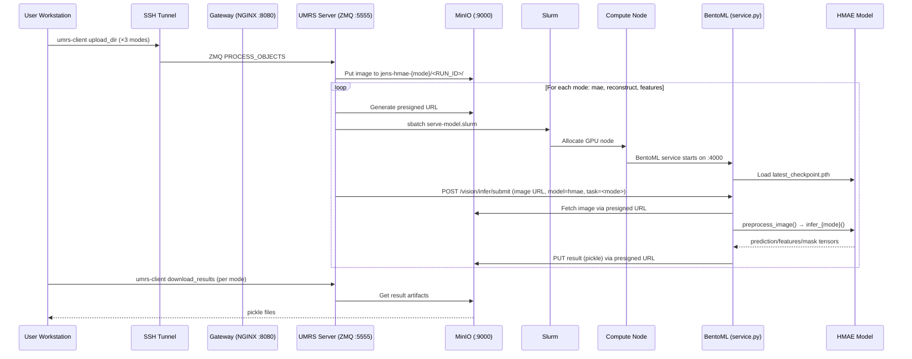

# Demo 12 — HMAE Direct: Technical Data & Calculation Flow

## Architecture Overview



## File Inventory

| File | Role |
|------|------|
| `12_hmae_direct/run_demo.sh` | Demo orchestrator (bash) |
| `demos/lib/common.sh` | Shared helpers: preflight, upload, download |
| `internal_genAI/bento/service.py` | BentoML service: model registry + inference dispatch |
| `internal_genAI/bento/hmaeinfer/infer.py` | HMAE inference: load, preprocess, reconstruct/mae/features |
| `internal_genAI/bento/hmaeinfer/configs/infer_hmae_vit_b.yaml` | Model config: img_size, patch_size, mask_ratio |
| `internal_genAI/bento/hmaeinfer/checkpoints/latest_checkpoint.pth` | HMAE model weights |
| `internal_genAI/bento/hmaeinfer/engine/hmae.py` | HierarchicalMaskedAutoEncoder quadtree engine |
| `internal_genAI/bento/hmaeinfer/model/` | ViT-B model architecture |
| `internal_genAI/bento/hmaeinfer/spring8concrete/` | Sample CT images (volume_170–175.png) |
| `internal_genAI/bento/Dockerfile` | Container image: Python 3.14 + torch + opencv |
| `internal_genAI/serve-model.slurm` | Slurm job: podman-compose orchestration |
| `internal_genAI/serve-model.yaml` | Compose file: NGINX → BentoML (as "litellm") |
| `internal_genAI/userdata-access.yaml` | Compose file: exit NGINX + CoreDNS for S3 access |

---

## Detailed Flow

### 1. Experience Generation (Three Modalities)

**File**: `12_hmae_direct/run_demo.sh` → `generate_experience()`

```python
# run_demo.sh lines 53-86 — inline Python generates the experience JSON
modes = [
    ("mae",         "jens-hmae-mae",         "mae_reconstruction"),
    ("reconstruct", "jens-hmae-reconstruct",  "reconstruction"),
    ("features",    "jens-hmae-features",     "feature_extraction"),
]
payload = {
    "xp_name": "Jens HMAE Direct",
    "sql_username": "jens_hmae_direct",
    "modalities": [],
}
for mode, bucket_alias, task in modes:
    payload["modalities"].append({
        "modality_name": "image",
        "task": task,
        "s3": {
            "bucket_alias": bucket_alias,
            "need_output_bucket": True,
            "data": {"type": "file", "mime_type": "image/png"},
        },
        "model": {
            "model_name": f"internal-genai-hmae-{mode}",
            "vector_size": "768",
            "model_type": "rivault://bentoml://http://localhost:{LOCAL_PORT}/vision/infer/submit",
            "vision_model_type": "hmae",
            "vision_model_config": {"task": task},
            "return_type": "file",
        },
        ...
    })
```

Each mode maps to a separate MinIO bucket and inference task:

| Mode | Bucket Alias | Task Name | Model Name |
|------|-------------|-----------|------------|
| `mae` | `jens-hmae-mae` | `mae_reconstruction` | `internal-genai-hmae-mae` |
| `reconstruct` | `jens-hmae-reconstruct` | `reconstruction` | `internal-genai-hmae-reconstruct` |
| `features` | `jens-hmae-features` | `feature_extraction` | `internal-genai-hmae-features` |

### 2. Image Source Auto-Detection

**File**: `12_hmae_direct/run_demo.sh` lines 14-21

```bash
# run_demo.sh lines 14-21 — prefer Spring-8 concrete images if present
if find "${SCRIPT_DIR}/../internal_genAI/bento/hmaeinfer/spring8concrete" \
        -maxdepth 1 -type f -name "*.png" 2>/dev/null | grep -q .; then
    IMAGE_DIR="${SCRIPT_DIR}/../internal_genAI/bento/hmaeinfer/spring8concrete"
else
    IMAGE_DIR="${SCRIPT_DIR}/../../demos/sample_data/images"
fi
```

Spring-8 concrete micro-CT slices are the scientifically appropriate input for HMAE:
- 1024×1024 grayscale PNG images
- Quadtree decomposition works best with structural detail at multiple scales

### 3. Per-Mode Upload Loop

**File**: `12_hmae_direct/run_demo.sh` lines 114-128

```bash
# run_demo.sh lines 114-128 — iterate over selected modes
while IFS= read -r mode; do
    alias="$(mode_alias "${mode}")"     # e.g. "jens-hmae-mae"
    task="$(mode_task "${mode}")"       # e.g. "mae_reconstruction"

    # Upload to mode-specific bucket
    umrs-client upload_dir "${UPLOAD_DIR}" "${alias}/${RUN_ID}"

    # Download results for this mode
    download_results_bounded "${alias}/${RUN_ID}" "${mode_results}/artifacts" --force-overwrite
done < <(selected_modes)
```

Mode resolution helpers:
```bash
# run_demo.sh lines 23-38
mode_task() {
    case "$1" in
        mae) echo "mae_reconstruction" ;;
        reconstruct) echo "reconstruction" ;;
        features) echo "feature_extraction" ;;
    esac
}
mode_alias() {
    case "$1" in
        mae) echo "jens-hmae-mae" ;;
        reconstruct) echo "jens-hmae-reconstruct" ;;
        features) echo "jens-hmae-features" ;;
    esac
}
```

### 4. HMAE Model Initialization

**File**: `internal_genAI/bento/service.py` → class `HMAE.__init__()`

```python
# service.py lines 28-73 — HMAE model loading and config parsing
from hmaeinfer.infer import load_model

args = parser.parse_args([
    "--config",
    str(next((p.resolve() for p in Path("/app/hmaeinfer").rglob("infer_hmae_vit_b.yaml")), None)),
    "--checkpoint",
    str(next((p.resolve() for p in Path("/app/hmaeinfer").rglob("latest_checkpoint.pth")), None)),
    "--device",
    "cuda" if torch.cuda.is_available() else "cpu",
    "--mode", "reconstruct"
])

with open(args.config, "r") as f:
    config = safe_load(f)

device = torch.device(config["inference"].get("device", "cpu"))
use_bf16 = False if device.type == "cpu" else config["inference"].get("use_bf16", True)
model = load_model(config, device)
```

**File**: `internal_genAI/bento/hmaeinfer/configs/infer_hmae_vit_b.yaml`

```yaml
model:
  model_type: "hvit_b"
  img_size: 1024
  patch_size: 32
  in_channels: 1          # grayscale
  mask_ratio: 0.5
  fixed_length: 1024
  norm_pix_loss: true

inference:
  checkpoint_path: "./checkpoints/latest_checkpoint.pth"
  device: "cuda"
  use_bf16: true
```

**File**: `internal_genAI/bento/hmaeinfer/infer.py` → `load_model()`

```python
# infer.py lines 38-65 — model loading with checkpoint
def load_model(config, device):
    model = create_model(
        model_type=model_cfg["model_type"],   # "hvit_b"
        img_size=model_cfg["img_size"],        # 1024
        patch_size=model_cfg["patch_size"],    # 32
        in_channels=model_cfg.get("in_channels", 1),
        mask_ratio=model_cfg.get("mask_ratio", 0.5),
        norm_pix_loss=model_cfg.get("norm_pix_loss", True),
    )
    checkpoint = torch.load(ckpt_path, map_location=device, weights_only=False)
    state_dict = checkpoint.get("model_state_dict", checkpoint)
    # Handle compiled model keys (remove _orig_mod. prefix)
    cleaned = {k.replace("_orig_mod.", ""): v for k, v in state_dict.items()}
    model.load_state_dict(cleaned, strict=False)
    model = model.to(device).eval()
    return model
```

### 5. Image Preprocessing — Quadtree Decomposition

**File**: `internal_genAI/bento/hmaeinfer/infer.py` → `preprocess_image()`

```python
# infer.py lines 68-110 — quadtree-based patch extraction
def preprocess_image(image_path, img_size=1024, in_channels=1,
                     fixed_length=1024, patch_size=32):
    # 1. Load grayscale image (1024×1024)
    full_image = cv2.imread(image_path, cv2.IMREAD_GRAYSCALE)
    full_image = cv2.resize(full_image, (img_size, img_size))

    # 2. Edge detection for adaptive quadtree
    blurred = cv2.GaussianBlur(gray, (5, 5), 0)
    edges = cv2.Canny(blurred, 50, 100)

    # 3. Quadtree decomposition (hierarchical patch extraction)
    engine = HierarchicalMaskedAutoEncoder(fixed_length=1024, patch_size=32)
    patches, coords, depths = engine.process_single(img_np, edges)

    return {
        "patches": patches.unsqueeze(0),         # [1, L, C, P, P] — L patches
        "coords": coords.unsqueeze(0),           # [1, L, 4]  — (x1,x2,y1,y2) per patch
        "depths": depths.unsqueeze(0),           # [1, L]     — quadtree depth
        "original_image": original.unsqueeze(0), # [1, C, H, W]
    }
```

The quadtree splits the image adaptively:
- Areas with high edge density → smaller patches (deeper quadtree)
- Uniform areas → larger patches (shallow quadtree)
- Fixed total patch count: `fixed_length=1024`

### 6. Three Inference Modes

**File**: `internal_genAI/bento/service.py` → `HMAE.inference()`

```python
# service.py lines 76-130 — HMAE inference dispatcher
def inference(self, image: str, task: str) -> dict:
    data = preprocess_image(img_path, ...)
    mode = task  # "reconstruct", "mae", "features"
```

#### Mode: `reconstruct` (Full Reconstruction)

**File**: `internal_genAI/bento/hmaeinfer/infer.py` → `infer_reconstruct()`

```python
# infer.py lines 113-123
@torch.no_grad()
def infer_reconstruct(model, data, device, config, use_bf16=True):
    patches = data["patches"].to(device)
    coords = data["coords"].to(device)
    depths = data["depths"].to(device)
    with autocast(device_type=device.type, dtype=torch.bfloat16):
        pred = model.reconstruct(patches, coords, depths)
    return pred.float().cpu()
```

Output: `{"prediction": tensor[1, L, patch_dim], "status": "success"}`

#### Mode: `mae` (Masked Reconstruction)

**File**: `internal_genAI/bento/hmaeinfer/infer.py` → `infer_mae()`

```python
# infer.py lines 126-137
@torch.no_grad()
def infer_mae(model, data, device, config, use_bf16=True):
    with autocast(device_type=device.type, dtype=torch.bfloat16):
        loss, pred, mask = model(patches, coords, depths)
    return pred.float().cpu(), mask.float().cpu(), loss.item()
```

Output: `{"prediction": tensor, "mask": tensor[1, L], "loss": float, "status": "success"}`

- `mask[i] == 1` → patch was masked during inference
- `loss` → MSE reconstruction loss (lower = better reconstruction quality)

#### Mode: `features` (Feature Extraction)

**File**: `internal_genAI/bento/hmaeinfer/infer.py` → `infer_features()`

```python
# infer.py lines 140-150
@torch.no_grad()
def infer_features(model, data, device, config, use_bf16=True):
    with autocast(device_type=device.type, dtype=torch.bfloat16):
        features = model.encode(patches, coords, depths)
    return features.float().cpu()
```

Output: `{"features": tensor[1, L+1, 768], "status": "success"}`

- `features[:, 0, :]` → CLS token (global image representation, 768-dim)
- `features[:, 1:, :]` → per-patch tokens

### 7. Container Topology on Compute Node

Same as Demo 11 (shared `serve-model.slurm`):

```
┌─ Compute Node ──────────────────────────────────────────────────┐
│                                                                 │
│  genai-private-net (e.g. 192.168.4.0/24)                       │
│  ┌──────────────────────────────────────────────────────────┐   │
│  │                                                          │   │
│  │  ┌─────────────────┐     ┌──────────────────────┐       │   │
│  │  │ NGINX (rivault) │────▶│ BentoML "litellm"   │       │   │
│  │  │ :RANDOM_PORT→4000│     │ service.py           │       │   │
│  │  └─────────────────┘     │ HMAE model loaded    │       │   │
│  │                          │ .20 on private net    │       │   │
│  │                          └──────────────────────┘       │   │
│  │                                                          │   │
│  │  ┌─────────────────┐     ┌──────────────────────┐       │   │
│  │  │ NGINX (exit)    │     │ CoreDNS              │       │   │
│  │  │ .252 private    │     │ .253 private          │       │   │
│  │  │ S3 proxy        │     │ "sshforwarded" →      │       │   │
│  │  │ :9000 exposed   │     │   LOCAL_IP            │       │   │
│  │  └─────────────────┘     └──────────────────────┘       │   │
│  └──────────────────────────────────────────────────────────┘   │
│                                                                 │
│  HMAE model mounts (read-only):                                │
│    /app/hmaeinfer/ ← checkpoints/, configs/, engine/, model/   │
│                                                                 │
│  SSH tunnel: LOCAL_IP:9000 ──▶ login-node:9000 (MinIO)         │
└─────────────────────────────────────────────────────────────────┘
```

Model weights and inference code are bind-mounted read-only:
```yaml
# serve-model.yaml lines 56-60
- type: bind
  source: ./bento/hmaeinfer/
  target: /app/hmaeinfer
  read_only: true
```

### 8. Result Serialization & Upload

**File**: `internal_genAI/bento/service.py` → `VisionFrontend.vision_task()`

```python
# service.py lines 423-441 — result upload to presigned URL
if out.lower().startswith(("http://", "https://")):
    req = Request(
        url=out,
        data=dumps(result, protocol=HIGHEST_PROTOCOL),
        method="PUT",
        headers={"Content-Type": "application/octet-stream"},
    )
    with urlopen(req, timeout=3600) as response:
        status_code = response.getcode()
```

All result tensors are serialized with `pickle.dumps(result, protocol=HIGHEST_PROTOCOL)` and uploaded to MinIO via presigned PUT URL.

---

## Data Format Summary

### Input
- **Format**: PNG/JPG/JPEG/TIF/TIFF image files
- **Preferred**: 1024×1024 grayscale PNG (Spring-8 CT slices)
- **Upload paths**: MinIO `jens-hmae-{mode}/<RUN_ID>/<filename>`

### Output Per Mode

#### `mae` (Masked Reconstruction)

| Key | Type | Shape | Description |
|-----|------|-------|-------------|
| `prediction` | `torch.Tensor` | `[1, L, patch_dim]` | Reconstructed patch pixels |
| `mask` | `torch.Tensor` | `[1, L]` | Binary mask (1 = was masked) |
| `loss` | `float` | scalar | MSE reconstruction loss |
| `status` | `str` | — | `"success"` |

#### `reconstruct` (Full Reconstruction)

| Key | Type | Shape | Description |
|-----|------|-------|-------------|
| `prediction` | `torch.Tensor` | `[1, L, patch_dim]` | Reconstructed patch pixels (all patches) |
| `status` | `str` | — | `"success"` |

#### `features` (Feature Extraction)

| Key | Type | Shape | Description |
|-----|------|-------|-------------|
| `features` | `torch.Tensor` | `[1, L+1, 768]` | CLS token + per-patch features |
| `status` | `str` | — | `"success"` |

Where:
- `L` = number of quadtree patches (fixed to 1024 by `fixed_length`)
- `patch_dim` = `in_channels × patch_size × patch_size` = `1 × 32 × 32 = 1024`

### Model Configuration

| Parameter | Value | Description |
|-----------|-------|-------------|
| `model_type` | `hvit_b` | Hierarchical ViT-Base |
| `img_size` | 1024 | Input image resolution |
| `patch_size` | 32 | Base patch size in pixels |
| `in_channels` | 1 | Grayscale |
| `mask_ratio` | 0.5 | MAE masking ratio (50%) |
| `fixed_length` | 1024 | Total quadtree patches |
| `norm_pix_loss` | true | Normalize pixel loss |
| `use_bf16` | true | BFloat16 inference (GPU only) |
